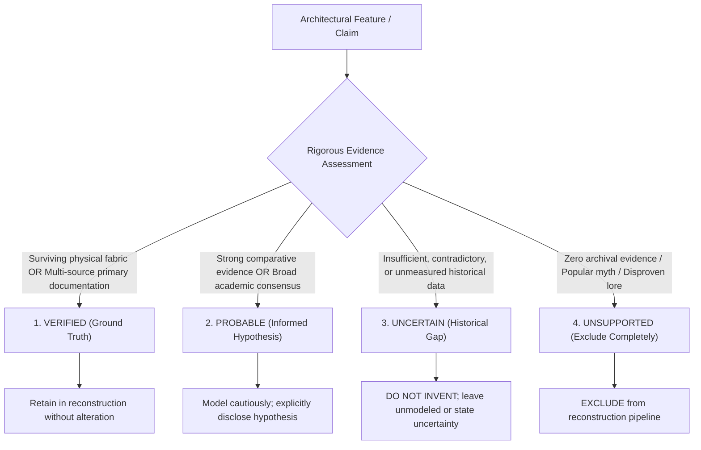

# Audited Uncertainty and Conflicting Claims Register: Hampi Stone Chariot
**Project:** Royal Heritage Platform — Historical Digital Reconstruction  
**Module:** Historical Digital Reconstruction (Phase 1.1 Evidence Audit)  
**Subject:** Vijaya Vittala Temple Stone Chariot (Garuda Shrine), Hampi, Karnataka  
**Document Classification:** Archaeological Rigor & Historical Verification Standard  
**Version:** 1.1.0  
**Audit Date:** November 2026  

---

## 1. Methodological 4-Tier Evidence Classification

To ensure strict historical and archaeological rigor and prevent speculative computer-generated fantasy, every claim, feature, and reconstruction hypothesis is systematically categorized into four unambiguous evidential tiers:

### Definitions:
1. **VERIFIED:** Directly documented in primary archival records (1856 Greenlaw calotype, 1856 Neill photograph RCIN 2603956), verified lithic epigraphy (*South Indian Inscriptions*), or surviving in-situ architectural fabric authenticated by the Archaeological Survey of India (ASI).
2. **PROBABLE:** Supported by credible historical or physical evidence, stylistic architectural typology of contemporary 16th-century Vijayanagara monuments, or early scholarly surveys (Longhurst 1917, Michell & Fritz 2001), but lacking definitive measurement or textual confirmation.
3. **UNCERTAIN:** Features where historical evidence is incomplete, unresolvable from 19th-century photographic resolution, or conflicting. *Must not be presented as established facts.*
4. **UNSUPPORTED:** Claims lacking primary evidence, popular tourist embellishments, or folkloric assumptions that have no foundation in the historical record. *Must be strictly excluded from reconstruction specifications.*

---

## 2. In-Depth Audit of Historical Claims & Myth Busting

### Item 1: The Construction Period & Patronage
* **Audit Finding:**
  * Inscriptions at the Vitthala temple record imperial endowments by Emperor Krishnadevaraya in 1513 CE and 1516 CE following his Kalinga campaigns (*South Indian Inscriptions*, Vol. IX, Nos. 491, 492).
  * However, **no lithic inscription explicitly records the foundation date or year of completion of the Stone Chariot itself.**
  * Architectural and stylistic analysis confirms it belongs to the mature imperial Vijayanagara Dravidian style characteristic of the early to mid-16th century.
* **Classification:**
  * General 16th Century CE Era: **VERIFIED** [SRC-ASI-01, SRC-UNESCO-02].
  * Patronage under Emperor Krishnadevaraya (r. 1509–1529 CE): **PROBABLE** [SRC-ASI-BK-04, SRC-ACAD-05].
  * Exact narrow date bracket (e.g., "1513 CE" or "c. 1510–1520 CE"): **UNCERTAIN**.
* **Reconstruction Mandate:** Attribute the monument to the 16th-century Vijayanagara imperial period under Krishnadevaraya's patronage, but do not claim an exact year as an established fact.

---

### Item 2: The Konark Sun Temple Inspiration Legend
* **Audit Finding:**
  * Popular guidebooks and websites frequently state that Krishnadevaraya ordered a replica of the Konark Sun Temple after visiting Odisha.
  * Contemporary epigraphs and foreign chronicles (Domingos Paes, Fernão Nuniz) make **zero mention of Konark**.
  * Chariot-shaped shrines (*ratha-vimanas*) have a centuries-old indigenous lineage in South Indian Dravidian architecture:
    - Pancha Rathas at Mamallapuram (7th c. Pallava).
    - Melakadambur Amritakateswarar temple (12th c. Chola).
    - Darasuram Airavatesvara temple (12th c. Chola).
    - Kumbakonam Sarangapani temple (13th c. Chola/Pandya).
* **Classification:** **UNSUPPORTED (Popular Myth / Artistic Parallel)**.
* **Reconstruction Mandate:** Exclude all Kalinga/Orissan architectural motifs. The reconstruction must follow Vijayanagara Dravidian architectural grammar exclusively.

---

### Item 3: The Missing Brick Vimana Superstructure & Height Measurement
* **Audit Finding:**
  * **Presence in 1856:** Conclusively proven by Colonel Alexander Greenlaw's 1856 waxed-paper calotype [SRC-PHOTO-06] and Dr. Andrew Charles Brisbane Neill's 1856 albumen print [SRC-PHOTO-07, RCIN 2603956].
  * **Absence by 1917:** Conclusively proven by A. H. Longhurst's survey [SRC-ASI-PUB-03, p. 131].
  * **Height Measurement:** Assigning an exact metric height (such as "3.2 meters") is **unsupported**, as the tower was never measured with a surveyor's rod or photogrammetric scale before its loss. In elevation photographs, its visual height is approximately equal to the height of the granite body (~1:1 proportional ratio).
  * **Tier Count & Detailing:** Shows a stepped pyramidal form, likely consisting of two main storeys (*talas*) and an upper neck (*griva*) crowned by a domical *sikhara* and *kalasa* finial. Fine stucco sculptures inside individual niches are obscured by 1856 calotype paper grain and cannot be identified.
* **Classification:**
  * Presence of superstructure in 1856: **VERIFIED** [SRC-PHOTO-06, SRC-PHOTO-07].
  * Stepped pyramidal silhouette and crowning sikhara: **VERIFIED** [SRC-PHOTO-06, SRC-PHOTO-07].
  * Proportional height (~1:1 ratio to granite body): **VERIFIED** [SRC-PHOTO-06].
  * Exact metric height in meters: **UNSUPPORTED / UNMEASURED**.
  * Tier count (2 receding storeys): **PROBABLE**.
  * Micro-stucco figural reliefs in niches: **UNCERTAIN**.
* **Reconstruction Mandate:** Reconstruct the superstructure conforming strictly to the 1856 photographic silhouette and proportional visual ratio. Do not invent arbitrary deity sculptures; base decorative motifs on surviving 16th-century Vijayanagara brick shrines (e.g., Hazara Rama temple complex).

---

### Item 4: Cause and Date of the Superstructure's Removal
* **Audit Finding:**
  * A widely repeated internet claim states that "British engineers ordered the brick tower dismantled in the late 19th century to relieve excess weight from the stone chassis."
  * Neither Longhurst (1917) nor Madras Public Works Department records contain any record of an executive demolition or weight-relief dismantling order.
  * The superstructure was lost or removed sometime between 1856 and 1917 due to unrecorded circumstances (e.g., progressive structural failure, storm/earthquake damage, or undocumented colonial clearing).
* **Classification:**
  * British demolition order to relieve weight: **UNSUPPORTED**.
  * Specific year of loss: **UNCERTAIN (Within the window 1857–1916 CE)**.
* **Reconstruction Mandate:** State accurately in educational texts that the superstructure was documented in 1856 and absent by 1917, without propagating the unverified "British demolition order" myth.

---

### Item 5: Stone Wheel Mechanics & Rotation in Festivals
* **Audit Finding:**
  * In-situ inspection confirms that four independent granite wheels (approx. 0.98m diameter) are mounted on cylindrical stone shafts passing through the chassis undercarriage [SRC-ASI-01].
  * Intentional mechanical clearance was carved around the axles.
  * Modern cementing: Mortar was placed around the axles in the 20th century by the ASI to halt tourist rotation and prevent frictional abrasion of the granite pins [SRC-ASI-01].
  * **Festival Usage:** The claim that these multi-ton stone wheels "regularly revolved during annual Brahmotsava temple festivals" is an **unsupported popular embellishment**. The structure is a static stone shrine (*vimana*); stone axles could not bear transport motion, and ritual rotation of architectural shrine wheels is unrecorded in Hindu liturgical literature (*Agamas*).
* **Classification:**
  * Four independent wheels on stone axles: **VERIFIED** [SRC-ASI-01].
  * Cementing by ASI in 20th century: **VERIFIED** [SRC-ASI-01].
  * Active ritual rotation during ancient festivals: **UNSUPPORTED**.
* **Reconstruction Mandate:** Retain authentic wheel geometry, carvings, and axle placements without asserting historical festival movement.

---

### Item 6: Front Guardian Elephants — Placement and Provenance
* **Audit Finding:**
  * In both 1856 photographic surveys (Greenlaw [SRC-PHOTO-06] and Neill [SRC-PHOTO-07]), the ground in front of the entrance steps is **completely clear**. The two stone elephants were **not present in 1856**.
  * By 1917, Longhurst [SRC-ASI-PUB-03, p. 131] recorded that the elephants had been placed there in modern times.
  * **Origin Myth:** Popular guidebooks assert the elephants were "brought from the Elephant Stables" or "transported from another temple." There are **zero archival transfer manifests** or archaeological excavation reports substantiating where they came from.
* **Classification:**
  * Absence in 1856: **VERIFIED** [SRC-PHOTO-06, SRC-PHOTO-07].
  * Presence in 1917: **VERIFIED** [SRC-ASI-PUB-03].
  * Status as modern conservation addition: **VERIFIED**.
  * Placement date: **PROBABLE (c. 1880–1910 CE during early site consolidation)**.
  * Origin from "Elephant Stables": **UNSUPPORTED**.
* **Reconstruction Mandate:** The elephants must be masked out or removed in any 16th-century historical reconstruction. Their specific origin must be described as unrecorded.

---

### Item 7: Original Draft Animals on Balustrades (Horses)
* **Audit Finding:**
  * On the surviving granite balustrades flanking the entrance steps, directly behind the modern elephants, in-situ relief carvings clearly depict the **hind legs, hocks, and falling tail curves of quadrupeds** [IMG-ARCH-IN-SITU-HORSE-05].
  * Longhurst [SRC-ASI-PUB-03, p. 131] identifies them as the remains of horses. This aligns with standard Dravidian chariot iconography (*ashva-sopana*).
  * **Missing Anatomy:** The animal forelegs, necks, heads, ears, manes, and harnesses severed centuries ago and are absent from all historical photographs.
  * **Museum Fragments Myth:** The assertion that "portions of the chariot horses are preserved in museum archives" is **unsupported**; no catalogued fragments of these horses exist in the ASI Kamalapuram Museum or the Government Museum, Chennai.
* **Classification:**
  * Relief carvings of draft animal hindquarters in-situ: **VERIFIED** [IMG-ARCH-IN-SITU-HORSE-05].
  * Identification as horses: **PROBABLE** [SRC-ASI-PUB-03].
  * Complete forequarter anatomy: **UNCERTAIN / LOST**.
  * Preserved fragments in museum collections: **UNSUPPORTED**.
* **Reconstruction Mandate:** In an authentic 16th-century reconstruction, draft horses may be modeled cautiously based on contemporary Vijayanagara horse carvings (e.g., Vittala Kalyana Mandapa), but their complete heads and harnesses must be explicitly flagged as an **informed hypothesis**, not documented physical fact.

---

### Item 8: Sanctum Cella Dimensions & Garuda Idol
* **Audit Finding:**
  * The interior cella is an elevated chamber enclosed by dressed granite wall panels with an east-west axial doorway facing the main Vitthala temple.
  * Stating exact decimal dimensions (e.g., "1.80m x 1.80m, wall thickness 0.35m") without a published laser scan represents field survey approximations rather than a certified modular standard.
  * Dedication to Garuda is attested by Agamic temple planning and ASI inventories [SRC-ASI-01, SRC-ASI-PUB-03].
  * The original consecrated Garuda murti was displaced or destroyed post-1565. Whether it was carved of black stone or cast in bronze is unrecorded.
* **Classification:**
  * Structural cella and west-facing doorway: **VERIFIED** [SRC-ACAD-05].
  * Dedication to Garuda: **VERIFIED** [SRC-ASI-01, SRC-ASI-PUB-03].
  * Exact cella dimensions: **PROBABLE (Field survey approximation ~1.5m – 2.0m)**.
  * Physical form, material, and features of the lost Garuda idol: **UNCERTAIN**.
* **Reconstruction Mandate:** Retain exterior cella architecture unchanged. Keep interior cella shadowed or show an empty altar pedestal; do NOT fabricate a fantasy deity sculpture.

---

### Item 9: Original Colour and Plaster Surface Treatment
* **Audit Finding:**
  * Microscopic traces of slaked-lime plaster (*sudha*) and red/yellow mineral pigment flecks survive in deep sheltered recesses under the chassis [SRC-ASI-01].
  * Foreign traveler accounts (Domingos Paes) and surviving Vijayanagara monuments (Lepakshi Veerabhadra temple) confirm that granite structures were systematically finished with burnished lime stucco and painting.
  * However, **no complete color map survives** for the Hampi Stone Chariot. Claiming specific multi-colored distributions (vermilion, ultramarine blue, lampblack borders across every molding) is an unsupported projection from other sites.
* **Classification:**
  * Application of lime plaster and painted pigment in antiquity: **VERIFIED** [SRC-ASI-01, SRC-ASI-BK-04].
  * Specific full-body polychrome color map: **UNSUPPORTED / SPECULATIVE**.
* **Reconstruction Mandate:** Maintain a natural granite and aged lime-wash texture for the visual reconstruction baseline. Avoid synthetic, brightly saturated modern CGI coloring.

---

## 3. Summary of Audited Claims by Classification Tier

| Architectural Element / Historical Claim | Previous Classification | Audited Classification | Traceable Source ID | Key Audit Action |
|---|---|---|---|---|
| **Interlocking Granite Plinth & Chassis** | VERIFIED | **VERIFIED** | SRC-ASI-01, SRC-ACAD-05 | Retained unchanged (100% authentic surviving fabric). |
| **Four Lotus Wheels on Independent Axles** | VERIFIED | **VERIFIED** | SRC-ASI-01, SRC-PHOTO-07 | Retained unchanged (100% authentic surviving fabric). |
| **Cementing of Axles by ASI in 20th C.** | VERIFIED | **VERIFIED** | SRC-ASI-01 | Retained unchanged (Verified conservation intervention). |
| **Presence of Brick Vimana in 1856** | VERIFIED | **VERIFIED** | SRC-PHOTO-06, SRC-PHOTO-07 | Retained unchanged (Proven by Greenlaw & Neill photos). |
| **Absence of Elephants in 1856** | VERIFIED | **VERIFIED** | SRC-PHOTO-06, SRC-PHOTO-07 | Retained unchanged (Proven by Greenlaw & Neill photos). |
| **Draft Animal Hindquarters Relief In-Situ** | VERIFIED | **VERIFIED** | IMG-ARCH-IN-SITU-HORSE-05 | Retained unchanged (Surviving relief carving behind elephants). |
| **Corner Pilasters & Pushpapotika Brackets** | VERIFIED | **VERIFIED** | SRC-ACAD-05, SRC-ASI-01 | Retained unchanged (100% authentic surviving fabric). |
| **Traces of Lime Plaster / Pigment in Recesses** | VERIFIED | **VERIFIED** | SRC-ASI-01, SRC-ASI-BK-04 | Retained unchanged (Microscopic traces verified by ASI). |
| **Dedication of Shrine to Garuda** | VERIFIED | **VERIFIED** | SRC-ASI-01, SRC-ASI-PUB-03 | Retained unchanged (Axial Agamic alignment with Vitthala). |
| **Construction Period (16th Century CE)** | VERIFIED | **VERIFIED** | SRC-ASI-01, SRC-UNESCO-02 | Retained as general period; narrow bracket qualified. |
| **Patronage under Emperor Krishnadevaraya** | VERIFIED | **PROBABLE** | SRC-ASI-BK-04, SRC-ACAD-05 | Downgraded from exact fact to probable attribution. |
| **Draft Animals Identified as Horses** | VERIFIED | **PROBABLE** | SRC-ASI-PUB-03 | Downgraded from fact to probable typological identity. |
| **Vimana Tier Count (2 Receding Talas)** | VERIFIED | **PROBABLE** | SRC-PHOTO-06, SRC-PHOTO-07 | Downgraded from fact to probable photographic interpretation. |
| **Approximate Plinth & Cella Dimensions** | VERIFIED | **PROBABLE** | SRC-ACAD-05 | Qualified as field survey approximations, not rigid modular standards. |
| **Elephant Placement Window (1857–1916)** | VERIFIED | **PROBABLE** | SRC-PHOTO-06, SRC-ASI-PUB-03 | Bounded between 1856 absence and 1917 presence. |
| **Exact Superstructure Metric Height (3.2m)** | ESTIMATED | **UNSUPPORTED** | None (Unmeasured) | Removed exact numerical figure; replaced with ~1:1 visual ratio. |
| **British Demolition Order to Relieve Weight** | PROBABLE | **UNSUPPORTED** | None (Unrecorded) | Removed as unrecorded folklore. |
| **Active Wheel Rotation in Ancient Festivals** | PROBABLE | **UNSUPPORTED** | None (Unrecorded) | Removed; stone shrine was static, not a moving festival cart. |
| **Elephants Originating from Elephant Stables** | PROBABLE | **UNSUPPORTED** | None (Unrecorded) | Removed; specific origin unrecorded in transfer logs. |
| **Museum Preservation of Horse Fragments** | DOCUMENTED | **UNSUPPORTED** | None (Unrecorded) | Removed; no catalogued horse fragments exist. |
| **Full-Body Polychrome Color Distribution Map** | PROBABLE | **UNSUPPORTED** | None (Unrecorded) | Removed; specific multi-colored scheme is speculative. |
| **Konark Sun Temple Direct Copying Myth** | PROBABLE | **UNSUPPORTED** | None (Unrecorded) | Removed; refuted by epigraphy and Dravidian ratha history. |
| **Physical Appearance of Lost Garuda Murti** | ESTIMATED | **UNCERTAIN** | None (Lost post-1565) | Retained as uncertain; interior cella to remain shadowed. |
| **Forequarter Anatomy of Draft Horses** | ESTIMATED | **UNCERTAIN** | None (Lost pre-1856) | Retained as uncertain; must not invent unrecorded details. |
| **Micro-Stucco Figural Relievos on Vimana** | ESTIMATED | **UNCERTAIN** | None (Calotype grain) | Retained as uncertain; must adhere to contemporary motifs. |

---

*This register represents the audited historical baseline governing all Phase 2 reconstruction tasks.*
